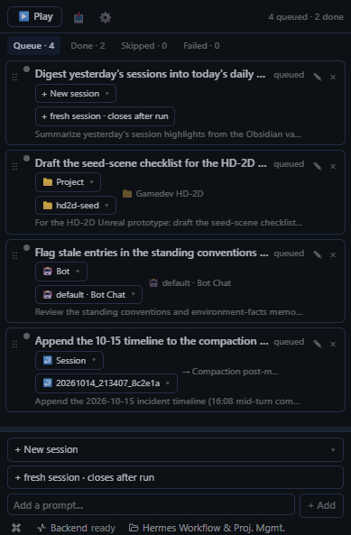

# Prompt Queue — Hermes Desktop plugin



Kanban-style prompt queue for the [Hermes desktop app](https://hermes-agent.nousresearch.com/docs).
Each card is a prompt **plus a target mode** — a fresh session (default), an
existing session, a desktop project, or a profile's canonical Bot Chat. Press
**▶ Play** and the queue drains strictly top-down: each card runs its prompt
in its target, waits for the turn to finish, waits for any
**background self-improvement review** to fully complete (strict gate), then
fires the next card. Fresh-session cards get a real visible sidebar session
that is closed after their turn; follow-up cards (session / bot modes) feed an
existing conversation and are never closed.

Built for feeding a local-model setup a list of prompts one at a time —
without the next prompt fighting the background review for the inference slot
— while keeping every created session visible in the normal sidebar.

## Who is this plugin for?

For people running **local models on scarce compute**: one inference slot,
**max parallelism = 1**. Every request — your prompts, the agent's background
self-improvement reviews, context compaction — serializes through the same
server, and firing two at once means they race (or steer each other) instead
of just waiting.

Prompt Queue is designed around exactly that constraint. You queue prompts as
cards; **▶ Play** releases them one at a time, and each one is only sent once
the model slot is **provably free** — no session working, any background
review fully complete, and context compaction committed. Your queued work
lines up *behind* the model's own maintenance tasks instead of racing them.

(On a cloud API where parallel requests are cheap you probably don't need the
gating — though batching prompts one-at-a-time is still handy.)

## What it adds

- **Pane** — docked below the session list (bottom-left of the default layout);
  drag it anywhere.
- **Cards** — add (textarea, Ctrl/⌘+Enter or **+ Add**), edit (✎), reorder
  (drag ⋮⋮), retry failed (↻), open the card's session (↗). The **×** on a
  card opens a small menu: **↷ Skip** (moves it to the Skipped tab),
  **✓ Mark done** (→ Done), or **✕ Delete** (removes it) — so an accidental ×
  no longer loses a prompt.
- **Queue / Done / Skipped / Failed tabs** — finished cards move off the
  Queue tab so it stays clean (live counts in the labels); Done and Skipped
  have a **✕ clear** button; only the Queue tab is drag-reorderable.
- **Strict review gate** — no new prompt is fired while a background
  memory/skill review is still running (detection: `review.summary` event +
  `thread=bg-review` log markers, 30 s spawn grace, 20 s poll, **fail-closed
  on log errors**: the queue holds with a visible `⏸ holding — review
  verification unavailable` state and retries until absence is confirmed;
  fail-open is an explicit opt-in in the gear). Orphaned spawn markers (the
  gateway died mid-review → no terminal line ever) release the lane after
  3 h instead of failing the card.
- **Compaction gate** — context compaction holds the same slot via its aux
  model call. Mid-turn runs are covered by the global session gate (the
  session reads `working`); the idle-resume compaction path is not, so a
  fresh (<60 min) compression start marker with no terminal line in
  `agent.log` also holds the lane (`⏳ waiting for compaction…`). Orphaned
  markers release — a dead run can't wedge the queue forever.
- **Slot hygiene** — after a card's turn, its one-shot session's
  active-session slot is released (`session.close`; the sidebar row stays), so a
  long queue can't exhaust the session cap.
- **Card targets — a MODE per card** — each card runs into one of four modes:
  a **new session** (default, one-shot), an **existing session** (picker of
  the latest 10 with a reply, or paste a session ID), a **project** (`📁`) —
  the picker's Project section lists the active profile's projects and a
  **＋ New project…** form (name + folder path); a project card always runs in
  a *fresh* session whose cwd is the project's primary path, so it appears
  under that project in the sidebar, and a "new project" card creates it
  first (idempotently — a retry or a second card on the same folder reuses it)
  — or a **bot** (`🤖`): the picker's Bot section lists this backend's
  profiles; a bot card feeds that profile's one canonical hidden **"Bot Chat"**
  session (created on first use if missing), so queued prompts accumulate in
  a bot's forever-chat instead of one-shot sessions. The engine resolves the
  mode at fire time; resolution failures fail the card with a readable error
  rather than wedging. Session and bot targets attach via `session.resume`
  (profile-scoped for bots) and are **never closed** by the plugin (the idle
  reaper frees their slot, as with any session you use); new- and project-mode
  sessions are one-shots, closed after their turn. Set at add time or per-card
  (`🎯 target ▾`); a queued card can be repointed before it fires. The gear's
  **Default mode** (New session / Bot Chat) sets the target for cards added
  without an explicit pick (the `::enqueue` chip) and the composer's starting
  point — every card can still be re-pointed afterwards.
- **Two-row target picker (composer)** — row 1 picks the destination kind
  (＋ New session / 📁 Project / 🤖 Bot / ↩ Session), row 2 picks the
  concrete target within it. An uncommitted pick never changes the card's
  live target, so a card can't be left pointed at nothing.
- **Markdown ingest (📥)** — point the pane header's 📥 menu at a folder of
  `.md` files (persisted; default `%USERPROFILE%\.hermes\prompt-queue`) and
  **⬇ Ingest → queue** turns each `## …` heading and `- [ ]` checkbox into a
  card (single-`#` lines are comments — the same contract the starter
  template documents in-file). Card title = the block's heading; prompt text
  stays complete for the receiving agent; target = your default mode,
  re-pointable per card. **＋ Folder + template** creates the folder and a
  `prompts.md` starter on first use — an existing file is never touched.
  Re-ingesting is safe: blocks are deduped by exact text against every card
  already in the queue (any tab), so unchanged files add nothing and an
  edited block adds its new version. Caps: 50 files / 256KB per file /
  200 cards per run. Windows-only for now — file access rides the gated
  `shell.exec` cmd.exe door (no fs API in the renderer; see Requirements).
- **Restart-safe** — queue state persists via plugin storage; a card running
  across an app restart is re-attached (or re-queued, never dropped).
- **`::enqueue{prompt="…"}` transcript directive** — a chat turn can
  *suggest* a card (deduped by a real `dedupeKey` prop). Default is
  **ask-first**: the directive renders a chip showing the suggested prompt
  itself (truncated ~200 chars; full text in the tooltip) that you click to
  accept (the platform contract marks directive attributes as untrusted
  model output); the gear (⚙, pane header) switches it to auto-add.
  Auto-add only fires while the message is still streaming — re-rendering an
  old transcript after a reload never re-queues its directives. Tell your
  agent the directive exists; it won't discover the name on its own.
- **Status bar chip** — right cluster: `queue · N active, M next` /
  `queue paused · M waiting` / `queue idle`.

## State machine

```
queued → launching → running → review-wait → done
              └────────┴─────────┴──┴─────────→ failed (with retry)
```

Per-card watchdogs: 10 s `busyBySession` poll (missed-event fallback),
12 h hard stall → `failed` (session left open, not force-closed). Sized for
local-model turns (observed 1–4 h on this box); real completions come from
`message.complete` + the poll, the stall is only the hung-session tripwire.
If the gateway queues a prompt behind a target's in-flight turn (submit
response `status: "queued"`), the card shows `⏳ queued in target` and
completes on the *drained* turn's completion, not the in-flight one.

## Install

**From the catalog** (once listed in the Nous Hermes plugin catalog):

```bash
hermes plugins install prompt-queue --enable
```

**From this repo** (disk plugin; single ESM `desktop/plugin.js` + `plugin.yaml`, no build step):

1. Clone the repo, then copy the `desktop/` contents into your desktop
   plugins dir — `~/.hermes/desktop-plugins/prompt-queue/desktop/` (or
   `$HERMES_HOME/desktop-plugins/prompt-queue/desktop/` when a profile is
   active). The directory must end in
   `.../prompt-queue/desktop/plugin.js`.
2. The app hot-reloads within seconds. If it doesn't appear: ⌘K →
   **Reload desktop plugins**. A load failure shows a toast naming the error.
3. Manage (enable/disable) in **Settings → Plugins**.

## Requirements

A desktop build recent enough for: `host.request` gateway RPCs
(`session.create`, `session.list`, `session.resume`, `prompt.submit`,
`session.close`, `session.active_list`, `projects.list`, `projects.create`,
`profiles.list`, `session.title`), `host.openSession`,
`host.onEvent('message.complete')`, `host.state.busyBySession`, `host.logs`,
`ctx.storage`, pane contributions with `dock`, and `TRANSCRIPT_DIRECTIVE_AREA`.
Developed and verified against the 2026-10 build (all of the above confirmed
in `tui_gateway/` contracts + `apps/desktop/src/sdk` source; bot-mode
resolution mirrors the desktop app's own canonical-chat contract).

Markdown ingest additionally needs, on the gateway host: **Windows** (the
file access rides the gated `shell.exec` cmd.exe door — `type`, `dir`,
`mkdir`, `echo >`, `certutil -f -decode`, `explorer`; interpreter script
flags are hard-blocked by the approval gate and never used) and a **bare
`python` on PATH** (used to run the tiny read helper as `python <file>` —
a file argument passes the gate where `python -c` does not). Without either,
the other features work normally; ingest reports a readable error.

## Trust & Autonomy

A card is not a draft — once the engine fires it, it becomes a **full agent
turn** in a real session, with that session's complete tool access
(terminal, files, web, whatever that profile allows). Queue prompts the way
you'd queue autonomous work.

**What the plugin does and doesn't touch:**

- **No network calls.** It never fetches or sends anything beyond the
  Hermes gateway RPCs listed in Requirements (same machine, same gateway).
- **No credential access.** It reads no keys, tokens, or profile data.
- **Log tail for the review gate.** It reads the last 1000 lines of
  `agent.log` (filtered for `bg-review` markers) to know when a background
  review is running. That log is your own, but it can contain content from
  *other* sessions; the gate parses timestamps and markers only — nothing is
  stored or displayed.

**Card sources and their trust level:**

| Source | Trust | Behavior |
|---|---|---|
| Textarea / picker (you typed it) | user-approved | added directly; runs only while Play is active |
| Markdown ingest (📥, you point at a folder of files **you wrote**) | user-approved — the files are your own disk content, read on your explicit click | blocks queued on click; exact-text dedupe against the whole queue; runs only while Play is active. Path is blocklist-validated (`& | < > ^ ; % "` + CR/LF rejected; trusted `%ENVVAR%` or drive-letter root) and every command argument is quoted once — the standard remediation for the CVE-2024-27980 / BatBadBut class, not escaping |
| `::enqueue{prompt="…"}` (a chat turn wrote it) | **untrusted model output** — the platform contract for transcript directives is that attributes are untrusted model output | default **ask-first**: renders a clickable chip; the card is added only when you click it (gear → *Suggested prompts: Auto-add* restores immediate add). Either way it runs only while Play is active |

The `::enqueue` path is the one a prompt injection could exploit: a
model-generated (or model-relayed, e.g. quoted from a web page or file)
directive can *suggest* a card you never typed yourself. By default it
**cannot** add one on its own — the chip waits for your click — and the gear
(⚙, pane header) is where that decision lives.

**Review gate semantics.** The gate holds the queue while a background
self-improvement review is running. If the log check itself fails (a
transient `host.logs` blip), the gate **fails closed by default**: the card
shows `⏸ holding — review verification unavailable` and the 20 s re-poll
retries until absence is confirmed. Fail-open is an explicit opt-in
(gear → *Review gate on error: Open*).

## Performance notes (local models)

Each card's default target is a **new session**. On local-model setups,
creating or switching sessions can mean (re)loading KV-cache context for the
session — a compute cost that grows with context length, and it's why a
frequent pattern here is fewer, longer sessions rather than many short ones.
Practical guidance:

- **One-shot, independent prompts** — the default (new session per card) is
  fine and keeps each run isolated.
- **Iterative work on the same topic** — point the cards at **one existing
  session** (🎯 target) so follow-ups reuse that session's context instead of
  paying a fresh load per card.
- Keep each prompt **self-contained**: a card in a new session has no memory
  of the other cards.

## Known limitations

- The engine never submits into a mid-turn session (one card at a time — the
  global gate also holds target cards whose session is mid-turn), but a card
  whose turn stalls >12 h fails with the session left running rather than
  force-closing it.
- Reorder only applies to non-live cards (a live card is mid-flight).
- The review gate is global (one review can run app-wide), matching the
  harness: a review spawned by *any* session gates the next card.
- One-prompt sessions never trigger their *own* background review (the nudge
  counters are per-session) — the gate covers reviews from any session, which
  is the inference-slot protection that matters.
- **Markdown ingest is Windows-only** and reads through the gated
  `shell.exec` cmd.exe door: paths must start with a `%ENVVAR%` or drive
  letter and may not contain `& | < > ^ ; % "` (the blocklist is what makes
  the single-quoting safe); files are read in 45-line windows, so an ingest
  of many large files issues one shell round-trip per window. A folder you
  don't own or a path with odd characters simply produces a readable error —
  nothing is ever written outside the folder you pointed it at (the only
  writes are `prompts.md` when you ask for the template, plus `_pq.b64` /
  `_pq_read.py` scratch files inside that same folder — the `.b64` is deleted
  immediately after each decode).

## License

[MIT](./LICENSE)